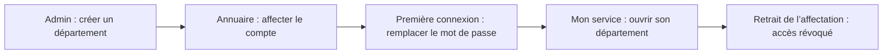

# Audit de l’application EJP Nantes — 16 octobre 2026

Les écritures de test utilisent une base isolée. La lecture de production a confirmé 2 comptes, aucun département et aucune affectation : aucun département fictif ni compte de test ne sont ajoutés au site.

| Bug confirmé | Correction vérifiée |
| --- | --- |
| La route Départements redirigeait vers le service personnel | Page de gestion rétablie et accessible depuis le menu admin et Mon service |
| Absence de département sans explication exploitable | État vide explicite et création accessible à l’administration |
| Département créé sans identifiant de navigation | Slug généré, doublons refusés, consultation par slug ou ID |
| Données personnelles interdites aux serviteurs | Accès contrôlé par propriétaire et périmètre ; données privées des autres utilisateurs refusées |
| Métadonnées absentes après création | Attribution au compte connecté côté serveur, valeurs par défaut des modèles appliquées aux nouvelles données |
| Liens admin ouvrant tous la même page | Annuaire, départements et onglets de configuration correctement ciblés |
| Rôles et badges admin interprétés différemment | Contrôles client et serveur alignés |
| Contenu masqué par les barres fixes | Espacement mesuré, zones sûres et limites de hauteur des panneaux adaptées |
| Erreurs de requêtes silencieuses | Messages d’erreur visibles et sortie de chargement rétablie sur les parcours corrigés |

| Zone de notifications invisible interceptant les clics en paysage | Conteneur non bloquant, fermeture et expiration des notifications rétablies |

## Vérifications réalisées

- Quatre suites automatisées passent : initialisation admin sans écrasement, API et persistance, serveur web, parcours départements et autorisations.
- Navigateur : création de département, affectation depuis la fiche d’annuaire, connexion du serviteur, remplacement du mot de passe initial et ouverture du département.
- 92 adresses internes visitées pour chacun des deux profils admin et serviteur : pas d’erreur JavaScript, d’erreur HTTP inattendue ni de débordement horizontal détecté à 390 × 844. Cela couvre la navigation, pas toutes les opérations de chaque écran.
- Contrôles responsive locaux : 55 combinaisons de pages et tailles lors de la correction des barres fixes.
- Navigation en paysage 844 × 390 : ouverture du panneau Plan STAR et limites du panneau vérifiées après correction des notifications.
- Isolation des notes privées, refus de l’auto-attribution de droits, retrait d’affectation et refus d’accès d’un compte suspendu vérifiés par tests serveur.

## Limites identifiées

Les connecteurs d’envoi de courriels, d’upload de fichiers, d’IA, de paiement et de visioconférence ne sont pas configurés sur le serveur autonome. Leur fonctionnement de bout en bout reste à traiter ; les tests ci-dessus ne les valident pas. Le bouton de notification de la boutique affiche actuellement une confirmation sans abonnement persistant. Les parcours FIJ ont été parcourus avec les deux profils testés, sans jeu métier complet de pilote et de coordination : cela ne constitue pas une validation de toutes leurs écritures.

Le présent correctif traite en priorité les départements, affectations, données personnelles et accès mobile. Il ne prétend pas garantir l’absence de tout bug dans l’ensemble de l’application.

Audit des dépendances : `npm audit --omit=dev` signale 25 vulnérabilités (8 modérées, 16 élevées, 1 critique dans jsPDF). Ces alertes demandent une analyse d’exposition et des mises à jour compatibles ; elles ne sont pas corrigées par cette livraison. Certaines corrections proposées changent de version majeure.

## Publication vérifiée

Le code du commit `b2e139a` est Live sur Render (déploiement `dep-db8oqtff3r2c73esj9ng`). Sur le domaine officiel, connexion admin, affichage de la gestion des départements et ouverture du formulaire de création vérifiés à 390 × 844. Le formulaire a été ouvert sans enregistrer de département fictif. Les sources corrigées sont aussi synchronisées dans le dossier local `ejp-nantes`.

## Correctif fichiers et intégrations — 16 octobre 2026

- Uploads réellement enregistrés dans `EJP_DATA_DIR/files`, sur le disque existant. Métadonnées dans SQLite ; aucun compte ni historique réinitialisé. Maximum 50 Mo par fichier, contrôle du type déclaré et de la signature, quotas de stockage pour préserver la base.
- Médias publics réservés à l’admin. Autres pièces jointes privées : propriétaire, admin, ou ressource publiée et lisible selon les droits existants. Les liens ne suffisent pas à contourner une révocation. Lecture partielle HTTP pour audio/vidéo.
- Photo de profil : ancien appel UploadPublicFile remplacé par un upload privé, visible selon les droits du profil. États d’upload libérés en cas d’échec.
- Boutique : abonnement idempotent enregistré en SQLite ; notification interne unique à la première publication d’un produit actif. Aucun email promis ni simulé. Les liens de paiement sont limités aux domaines Stripe HTTPS. Aucune commande n’est marquée payée par la plateforme sans confirmation de paiement.
- IA : assistant accessible dans Mes Ressources, via OpenAI Responses, réponse libre ou JSON validé, secret exclusivement serveur, stockage de réponse désactivé chez le fournisseur, délai maximal et limite quotidienne. Aucune action métier automatique ni accès implicite aux documents privés.
- Emails : adaptateur Resend, destinataire et permissions vérifiés, journal après acceptation fournisseur. Acceptation distinguée de livraison.
- Meet : adaptateur Google Calendar avec refresh OAuth, événement enregistré comme source de vérité, fuseau Europe/Paris et identifiant Google déterministe pour éviter les doublons à la relance.
- Administration : Fichiers & Intégrations affiche la présence de configuration sans exposer de secret ; ce statut ne prétend pas prouver la délivrabilité ni la validité des clés.
- Dépendances : mises à jour compatibles, React Router 7 ; suppression de jsPDF et de l’éditeur Quill inutilisés. `npm audit --omit=dev` : 0 vulnérabilité. L’audit complet conserve 7 alertes (5 élevées, 2 modérées) dans le compilateur Tailwind 3 et ses dépendances de développement. Leur suppression nécessite une migration Tailwind 4 avec vérification visuelle et compatibilité navigateurs ; elle n’est pas présentée comme accomplie.

### Limites de validation des fournisseurs

Les noms des paramètres Render ont été lus sans afficher les valeurs. Aucune clé OpenAI, Resend ou OAuth Google n’était configurée au moment du contrôle. Les adaptateurs ont été testés avec des réponses HTTP simulées, sans envoi à de vrais destinataires et sans achat d’API. Les erreurs 503 sans clé et les refus de permission sont vérifiés. Une validation réelle par fournisseur reste nécessaire après configuration.

### Paramètres à renseigner dans Render, jamais dans Git ou dans le navigateur

- IA : OPENAI_API_KEY ; OPENAI_MODEL facultatif, défaut gpt-5-mini. EJP_AI_DAILY_LIMIT facultatif, défaut 20 par compte.
- Emails : RESEND_API_KEY ; EJP_EMAIL_FROM (adresse sur domaine vérifié chez Resend).
- Meet : GOOGLE_CLIENT_ID ; GOOGLE_CLIENT_SECRET ; GOOGLE_REFRESH_TOKEN ; GOOGLE_CALENDAR_ID facultatif (défaut primary). Le compte Google doit autoriser l’API Calendar et la création de conférences Meet.
- Boutique : renseigner un Payment Link Stripe HTTPS par produit. Le lien existe chez Stripe ; cette livraison n’ajoute pas de webhook de commande ou de traitement de carte.

Références techniques : [OpenAI Responses](https://developers.openai.com/api/docs/guides/text), [Resend Send Email](https://resend.com/docs/api-reference/emails/send-email), [Google Calendar events.insert](https://developers.google.com/workspace/calendar/api/v3/reference/events/insert).
